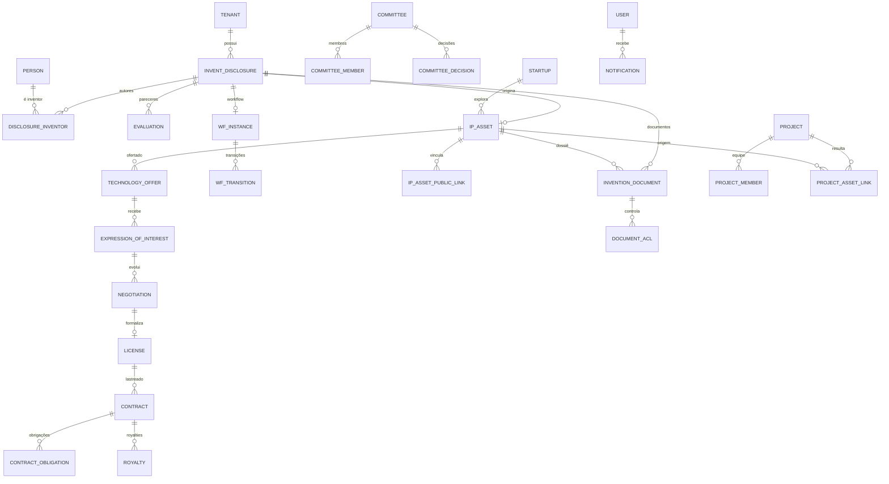

# Modelo de Domínio — Estado Atual e Proposta para NIT

**Data:** 2026-10-09
**Natureza:** Auditoria somente leitura. **Nenhuma migração ou modelo foi criado.**

---

## 1. Modelo ATUAL comprovado no código

### 1.1 Hierarquia de tenancy e identidade

- **`Tenant`** (raiz, sem `tenant_id`): `social_reason`, `company_name`, `cnpj`, `mcp_api_key`, `active` **[CÓDIGO]**.
- **`User`** (credenciais): `access_code`, `password_hash`, `type`, `mfa`, `tenant_id` (default), 1:1 → `Person` **[CÓDIGO]**.
- **`Person`** (cadastro): `name`, `cpf`, `email`, `cell_phone`, endereço, `responsibility`, `job_title`; `tenant_id` nullable; 1:1 → `User` **[CÓDIGO]**.
- **`UserTenant`** (N:N): associação multi-tenant **[CÓDIGO]**.
- **`Company`** (tenant-scoped): empresa do grupo **[CÓDIGO]**.
- **`Unity`** (tenant-scoped, `company_id`): filial/unidade, `matriz_type` **[CÓDIGO]**.
- **`Customer`** (tenant-scoped): cliente, vinculável a Company/Unity/Person **[CÓDIGO]**.
- **`Department`** (tenant-scoped): departamento **[CÓDIGO]**.

### 1.2 RBAC

- **`Module`** (10) → **`Resource`** (25) → políticas.
- **`Role`** → `RolePermission` → `Permission` (52); `RoleModule`.
- **`UserPolicy` / `GroupPolicy` / `RolePolicy`** — três caminhos; `Group`, `UserGroup` **[CÓDIGO]**.
- **Menu**: `Menu` → `MenuItem` → `MenuItemResource` **[CÓDIGO]**.

### 1.3 PI pública (dados abertos, GLOBAIS — sem tenant)

- **Marcas**: `marcas` + `marcas_depositantes`, `marcas_classificacoes_nice/nacionais/viena`, `marcas_despachos`, `marcas_logos` **[CÓDIGO]**.
- **Patentes**: `patentes` + `patentes_conteudo`, `patentes_depositantes`, `patentes_inventores`, `patentes_procuradores`, `patentes_prioridades`, `patentes_classificacao_ipc`, `patentes_despachos`, `patentes_renumeracoes`, `patentes_vinculos` **[CÓDIGO]**.
- **Vínculo**: `codigo_interno` (lógico, sem FK) **[CÓDIGO]**.

### 1.4 Monitoramento e operação

- **`MarcaMonitoramento` / `PatenteMonitoramento`**: `tenant_id` + `user_id` + `codigo_interno` **[CÓDIGO]**.
- **Ingestão**: `InpiDataset`, `InpiImport`, `InpiImportError`, `InpiImportCheckpoint`, `InpiRpi` **[CÓDIGO]**.
- **Auditoria**: `AuditLog` (`tenant_id`, `user_id`, `action`, `resource`, `meta` JSONB, `ip`, `user_agent`) **[CÓDIGO]**.

### 1.5 Diagrama ER do modelo ATUAL

```mermaid
erDiagram
    TENANT ||--o{ USER : "possui"
    TENANT ||--o{ COMPANY : "possui"
    TENANT ||--o{ DEPARTMENT : "possui"
    TENANT ||--o{ TENANT_MODULE : "habilita"
    MODULE ||--o{ TENANT_MODULE : "habilitado em"
    COMPANY ||--o{ UNITY : "tem filiais"
    COMPANY ||--o{ CUSTOMER : "atende"
    UNITY ||--o{ CUSTOMER : "atende"
    PERSON ||--o| USER : "1:1"
    TENANT ||--o{ PERSON : "possui"
    USER ||--o{ USER_TENANT : "pertence"
    TENANT ||--o{ USER_TENANT : "agrega"
    USER ||--o{ USER_ROLE : "tem"
    ROLE ||--o{ USER_ROLE : "concedido"
    ROLE ||--o{ ROLE_PERMISSION : "concede"
    PERMISSION ||--o{ ROLE_PERMISSION : "concedida"
    MODULE ||--o{ RESOURCE : "contém"
    MODULE ||--o{ PERMISSION : "agrupa"
    ROLE ||--o{ ROLE_POLICY : "política"
    RESOURCE ||--o{ ROLE_POLICY : "alvo"
    USER ||--o{ USER_POLICY : "política direta"
    RESOURCE ||--o{ USER_POLICY : "alvo"
    GROUP ||--o{ GROUP_POLICY : "política de grupo"
    GROUP ||--o{ USER_GROUP : "membros"
    USER ||--o{ USER_GROUP : "membro"
    USER ||--o{ REFRESH_TOKEN : "sessões"
    TENANT ||--o{ AUDIT_LOG : "trilha"
    USER ||--o{ MARCA_MONITORAMENTO : "monitora"
    TENANT ||--o{ MARCA_MONITORAMENTO : "escopo"
    TENANT ||--o{ INPI_DATASET : "n/a (global)"
    INPI_DATASET ||--o{ INPI_IMPORT : "execuções"
    INPI_IMPORT ||--o{ INPI_IMPORT_ERROR : "erros"
    MARCA ||--o{ MARCA_DEPOSITANTE : "codigo_interno (lógico)"
    MARCA ||--o{ MARCA_DESPACHO : "codigo_interno (lógico)"
    PATENTE ||--o{ PATENTE_INVENTOR : "codigo_interno (lógico)"
    PATENTE ||--o{ PATENTE_DESPACHO : "codigo_interno (lógico)"
```

---

## 2. O que NÃO existe hoje (confirmado)

**Nenhuma** entidade de NIT **[CÓDIGO]**:
- comunicação de invenção, parecer, comitê, decisão;
- ativo institucional interno, licença, contrato, obrigação, royalty;
- projeto de P&D, financiador, laboratório;
- startup, spin-off;
- documento/anexo de qualquer tipo;
- notificação;
- workflow/máquina de estados.

---

## 3. Modelo FUTURO recomendado (conceitual)

> Dependente de confirmação do responsável pelo produto (ver `QUESTIONARIO_DECISOES_PRODUTO_NIT.md`).

### 3.1 Entidades existentes que devem ser MANTIDAS

`Tenant`, `User`, `Person`, `Company`, `Unity`, `Department`, `UserTenant`, todo o RBAC, `Marca`/`Patente` e tabelas-filhas, monitoramentos, auditoria, ingestão. **Não alterar** — a fundação está testada.

### 3.2 Entidades existentes a ESTENDER

| Entidade | Extensão proposta | Justificativa |
|---|---|---|
| `Person` | papel de pesquisador/inventor; vínculo com unidade | NIT precisa identificar inventores |
| `Company` | tipo de parceiro (empresa/ICT/financiador) | Prospecção de TT |
| `Customer` | pipeline de negociação | TT |

### 3.3 Novas entidades candidatas

**Núcleo NIT (Fase 1):**

- `InventionDisclosure` — comunicação de invenção: protocolo, título, resumo, data, status, tenant, unidade, criador.
- `DisclosureInventor` — N:N comunicação ↔ `Person` (com percentual de contribuição).
- `InventionDocument` — documento/anexo com `confidentiality_level`, `storage_key`, `mime`, `sha256`, `uploaded_by`.
- `IPAsset` — ativo institucional: tipo (marca/patente/software/desenho/know-how), título, status, tenant, unidade.
- `IPAssetPublicLink` — vínculo ativo interno ↔ registro público (`codigo_interno`/`numero_inpi`), preservando procedência.
- `WorkflowState` / `WorkflowTransition` — máquina de estados configurável.
- `Evaluation` — parecer (tipo: técnico/jurídico/comercial), decisão, justificativa, avaliador.
- `Committee` / `CommitteeMember` / `CommitteeDecision` — comitê e decisões.

**Fase 3 (TT e contratos):**

- `TechnologyOffer` — item de catálogo.
- `ExpressionOfInterest` — manifestação de empresa.
- `Negotiation` / `License` / `Assignment`.
- `Contract` / `ContractObligation` / `Royalty`.

**Fase 4:**

- `Project` / `ProjectMember` / `Funder` / `ProjectMilestone` / `ProjectAssetLink`.
- `Startup` / `IncubationProgram`.

**Transversais:**

- `Notification` — notificações a usuários.
- `DocumentAcl` — permissões documentais explícitas.

### 3.4 Regras de integridade propostas

- Todo novo modelo carrega `tenant_id` + `UUIDPrimaryKeyMixin` + `TimestampMixin` + `SoftDeleteMixin`.
- `IPAssetPublicLink` referencia registro público **sem FK dura** (dados globais), mas guarda `source` + `synced_at` para procedência.
- `InventionDocument.confidentiality_level` é obrigatório; o acesso é validado por `DocumentAcl` **e** RBAC.
- Transições de workflow são validadas por regra explícita (não por campo livre).

### 3.5 Diagrama ER do modelo FUTURO (conceitual)

---

## 4. Ponto crítico de desenho — separação de conceitos

A auditoria **confirma** a necessidade de distinguir 5 coisas que **não devem** ser misturadas:

1. **Registro público do INPI** (`marcas`, `patentes` — globais, read-only, importados).
2. **Ativo institucional interno** (`IPAsset` — do tenant, editável).
3. **Comunicação de invenção** (`InventionDisclosure` — pré-depósito).
4. **Processo de PI em andamento** (workflow/estado).
5. **Contrato/licença** (instrumento associado ao ativo).

O vínculo entre 1 e 2 deve ser feito por uma tabela de referência (não por FK dura), preservando a procedência e o histórico de sincronização. Essa é a **decisão de modelo mais importante** antes de implementar.

---

## 5. Pontos dependentes de confirmação

- Um tenant pode ter múltiplas instituições? (multi-campus).
- Escopo de documentos: global, por unidade ou por dossiê?
- Workflow: fixo ou configurável por instituição?
- Ativo pode existir sem comunicação de invenção de origem?
- Um pesquisador externo (outra instituição) pode ser inventor?

Ver `QUESTIONARIO_DECISOES_PRODUTO_NIT.md`.