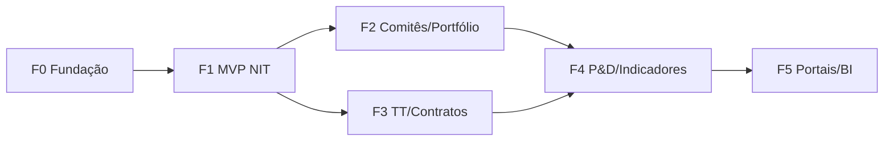

# Roadmap de Execução — Evolução NIT (F0–F5)

**Data:** 2026-10-09 · **Natureza:** Planejamento. Nenhuma implementação iniciada.
**Complementa:** `ROADMAP_IMPLEMENTACAO_NIT.md` (auditoria preservada), com escopo técnico, testes, DoD, estimativas e exclusões explícitas por fase.

> Estimativas são **faixas** e dependem de equipe (não informada), respostas às decisões e aprofundamento do modelo. **Não são compromissos.**

---

## F0 — Governança e segurança da fundação

> **STATUS (2026-10-09): PARCIALMENTE EXECUTADA.** Itens independentes de decisão foram
> **implementados e testados** (R-04, R-08, R-10, 500-safe/409). Backup/restore tem runbook e
> scripts, mas a **execução real está bloqueada** (sem `pg_dump`/ambiente isolado → S1).
> Observabilidade ativa e rate limiting distribuído dependem de S1. Ver `RELATORIO_F0_FUNDACAO.md`.

| Item | Detalhe |
|---|---|
| **Objetivo** | Tornar a evolução segura e reversível antes de qualquer entidade de NIT. |
| **Escopo funcional** | Nenhuma funcionalidade de usuário final. |
| **Escopo técnico** | Git remote privado + proteção de `main` + versionar `docs/`; boot falha com segredo default; `pg_dump` agendado + restore testado + RTO/RPO; logging estruturado + correlação; handler 500 registra stack; validar papel por tenant (R-08). |
| **Dependências** | Decisão **S1** (alvo de infra) para backup/logging. |
| **Arquivos prováveis** | `backend/app/config.py`, `backend/app/main.py`, `backend/app/routers/admin/users.py`, scripts de ops, `.gitignore`. |
| **Entidades/migrations** | Nenhuma. |
| **Testes** | Teste de config (boot com default levanta erro); teste de atribuição de papel por tenant; execução documentada de restore. |
| **Riscos** | Baixo. |
| **Critérios de aceite** | `git remote -v` não vazio e branch protegida; boot recusa segredo default; restore reproduzido em ambiente limpo; erro 5xx gera log com stack. |
| **DoD** | Todos os critérios + suíte 94/94 verde + runbook de backup documentado. |
| **Estimativa** | **1–2 semanas** (premissa: 1 dev + acesso a infra). |
| **Fora de escopo** | Qualquer entidade de NIT; rate limiting distribuído; MFA (vai para piloto/produção). |

**Matriz de Riscos cobertos:** R-02, R-04, R-08, R-09, R-10, R-14.

---

## F1 — MVP: comunicação de invenção e ativos internos

| Item | Detalhe |
|---|---|
| **Objetivo** | Registrar/tramitar comunicações de invenção com documentos confidenciais, workflow e portfólio. |
| **Escopo funcional** | Submissão de comunicação (pesquisador/NIT); inventores internos e externos sem conta; anexos com confidencialidade; workflow Proposta→Triagem→Parecer→Decisão com alçadas; ativo institucional + vínculo opcional a registro público; escopo por tenant/unidade; histórico; dashboard operacional. |
| **Escopo técnico** | Módulo `NIT` no catálogo: permissões `NIT_*`, recursos, roles. Novas tabelas (§5.1 de `ARQUITETURA_ALVO_NIT.md`). Serviços `storage.py`, `workflow.py`, `protocol.py`. Aplicar `scoped_resources`. Frontend: `app/nit/*` + agrupamento no `AppShell`. |
| **Dependências** | F0 + decisões **D1/D2/D5, E1/E4, I1/I3, P1/P2/P4, S4**. |
| **Arquivos prováveis** | `models/nit.py`, `schemas/nit.py`, `routers/nit/*`, `services/*`, `constants.py`, `app/nit/*`, `AppShell.tsx`. |
| **Entidades/migrations** | `InventionDisclosure`, `DisclosureInventor`, `InventionDocument`, `DocumentAcl`, `WorkflowState/Transition/Instance`, `Evaluation`, `IPAsset`, `IPAssetPublicLink` — 1–3 migrações aditivas (não geradas aqui). |
| **Testes** | Isolamento tenant **e** unidade; ACL de documento; transições inválidas; vínculo público; MIME/tamanho; protocolo único. |
| **Riscos** | R-03 (docs), R-01 (escopo), R-07 (busca), R-12. |
| **Critérios de aceite** | Pesquisador submete comunicação com anexo confidencial; outro tenant/unidade não a vê; comitê decide; ativo é criado e vinculado (opcionalmente) a um registro do INPI. |
| **DoD** | Critérios + migração com downgrade + 94 testes verdes + auditoria de download + docs OpenAPI. |
| **Estimativa** | **8–14 semanas** (premissa: 1–2 devs sênior; armazenamento já provisionado). |
| **Fora de escopo** | TT, contratos, P&D, startups, portais externos, FORMICT, BI avançado. |

**Riscos cobertos:** R-01, R-03, R-07, R-12 + R-19 (testes da fase).

---

## F2 — Avaliação avançada, comitês e portfólio

| Item | Detalhe |
|---|---|
| **Objetivo** | Aprofundar triagem e gestão de portfólio. |
| **Escopo funcional** | Pareceres técnico/jurídico/comercial, TRL, potencial comercial; comitês formais com voto e conflito de interesse; custos/anuidades/família de patentes e alertas de manutenção; indicadores básicos de NIT. |
| **Escopo técnico** | `Committee`, `CommitteeMember`, `CommitteeDecision`; campos TRL/custo; agregações para indicadores; alertas (padrão de monitoramento). |
| **Dependências** | F1. |
| **Entidades/migrations** | Novas tabelas de comitê + colunas aditivas em `Evaluation`/`IPAsset`; 1–2 migrações. |
| **Testes** | Alçadas, votos, quórum, conflito de interesse, alertas de prazo; concorrência de transição. |
| **Riscos** | R-13 (contagem), R-16 (sync). |
| **Critérios de aceite** | Comitê registra decisão com quórum; indicadores batem com os dados; alerta de anuidade dispara. |
| **DoD** | Critérios + testes de concorrência + regressão verde. |
| **Estimativa** | **6–10 semanas**. |
| **Fora de escopo** | Contratos/royalties (F3), BI customizável (F5). |

---

## F3 — Transferência tecnológica e contratos

| Item | Detalhe |
|---|---|
| **Objetivo** | Ofertar tecnologias, gerir negociações e contratos. |
| **Escopo funcional** | Catálogo de ofertas; manifestação de interesse; pipeline de negociação; licença/cessão; contratos com vigência, obrigações e registro de royalties; alertas de vencimento. |
| **Escopo técnico** | `TechnologyOffer`, `ExpressionOfInterest`, `Negotiation`, `License`, `Assignment`, `Contract`, `ContractObligation`, `Royalty`; documentos contratuais reusando o módulo documental. |
| **Dependências** | F1 (ativos); F2 recomendada. **Paralelizável com F2** após F1. |
| **Testes** | Pipeline, obrigações, royalties, vigência, NDA, acesso restrito a contratos. |
| **Riscos** | Financeiro mal desenhado (F2 do questionário: registrar, não contabilizar). |
| **Critérios de aceite** | Ativo ofertado → interesse → negociação → licença → contrato com obrigações registradas. |
| **DoD** | Critérios + testes + regressão verde. |
| **Estimativa** | **8–12 semanas**. |
| **Fora de escopo** | Integração contábil/financeira institucional; BI avançado. |

---

## F4 — P&D, startups e indicadores ampliados

| Item | Detalhe |
|---|---|
| **Objetivo** | Vincular projetos e startups aos ativos; consolidar indicadores. |
| **Escopo funcional** | Projetos de P&D, equipe, financiadores, marcos; startups/incubação; vínculo projeto↔ativo↔startup; dashboard de NIT e apoio ao FORMICT. |
| **Escopo técnico** | `Project`, `ProjectMember`, `Funder`, `ProjectMilestone`, `ProjectAssetLink`, `Startup`, `IncubationProgram`; relatórios institucionais. |
| **Dependências** | F2 + F3. |
| **Testes** | Vínculos N:N, indicadores, export institucional. |
| **Riscos** | R-17 (schema fonte), escopo de P&D. |
| **Critérios de aceite** | Projeto mapeia ativos gerados; indicadores institucionais exportáveis. |
| **DoD** | Critérios + testes + regressão verde. |
| **Estimativa** | **8–12 semanas**. |
| **Fora de escopo** | Portais externos e SSO (F5). |

---

## F5 — Portais externos, BI e integrações

| Item | Detalhe |
|---|---|
| **Objetivo** | Autosserviço para pesquisadores e empresas. |
| **Escopo funcional** | Portal do pesquisador (submissão, acompanhamento, notificações); portal de empresas (catálogo, manifestação, NDA digital); BI customizável; avaliar SSO. |
| **Escopo técnico** | Perfis restritos, notificações (e-mail/in-app), geração de tipos de OpenAPI (R-18), integrações (SIGA/SEI/e-mail). |
| **Dependências** | F1–F4. |
| **Testes** | Acesso de externo ao escopo correto; notificações; acessibilidade; contrato de tipos. |
| **Riscos** | R-05 (sessão), R-18 (drift). |
| **Critérios de aceite** | Pesquisador externo submete e acompanha sem ver dados de terceiros. |
| **DoD** | Critérios + testes + regressão verde. |
| **Estimativa** | **10–16 semanas**. |
| **Fora de escopo** | Nada definido além do roadmap. |

---

## Dependências entre fases e caminho crítico

- **Caminho crítico:** F0 → F1 → F2 → F4 → F5.
- **Paralelizável:** F3 em paralelo a F2 (ambos dependem apenas de F1).
- **MVP comercial:** F0 + F1 (+ F2 se viável). **Pós-MVP:** F3, F4, F5.
