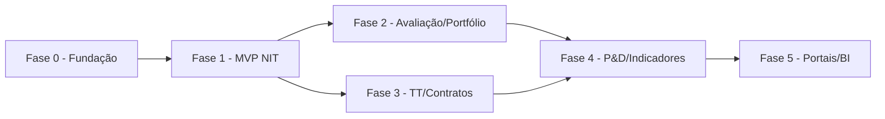

# Roadmap de Implementação — Plataforma SaaS de Gestão de NIT

**Data:** 2026-10-09
**Natureza:** Planejamento. **Nenhuma implementação foi iniciada.**

> As estimativas são **faixas** e dependem de: equipe (não informada), respostas ao questionário de produto, e aprofundamento do modelo de domínio. Não devem ser tratadas como compromissos.

---

## Fase 0 — Fundação e saneamento (não-funcional)

**Objetivo de negócio:** Garantir que a evolução seja segura e reversível.
**Problema resolvido:** Ausência de governança de código, segredos default, ausência de backup.

| Item | Detalhe |
|---|---|
| Inclui | Inicializar git + remote; proteger branch; falhar boot com segredos default; backup `pg_dump` agendado + teste de restore; logging estruturado; responder decisões críticas do questionário |
| Exclui | Qualquer entidade de NIT |
| Entidades afetadas | Nenhuma (só `config.py` e infra) |
| Arquivos prováveis | `backend/app/config.py`, `main.py`, scripts de ops, `.gitignore` |
| Migrações | Nenhuma |
| Segurança | S1/S2/S4/S10 da matriz |
| Testes | Teste de config (boot com default falha); teste de restore |
| Dependências | Nenhuma |
| Riscos | Baixo |
| Critérios de aceite | `git log` existe; boot recusa segredo default; restore validado |
| Complexidade | Baixa · **Estimativa: 1–2 semanas** |

---

## Fase 1 — MVP NIT (núcleo)

**Objetivo:** Registrar comunicações de invenção, gerir documentos confidenciais e o workflow básico, com portfólio de ativos.

**Funcionalidades incluídas:**
- Modelo de documentos com níveis de confidencialidade + ACL + storage privado (D1/D2/D5).
- `InventionDisclosure` + `DisclosureInventor` + `InventionDocument`.
- Workflow configurável (Proposta → Triagem → Parecer → Decisão) + alçadas (E1/E4).
- `IPAsset` + `IPAssetPublicLink` (I1/I3).
- Telas: comunicações, detalhe, portfólio, ativo.
- Permissões novas no catálogo (`NIT_*`).

**Funcionalidades excluídas:** TT, contratos, P&D, startups, portais externos, FORMICT.

| Item | Detalhe |
|---|---|
| Entidades | `InventionDisclosure`, `DisclosureInventor`, `InventionDocument`, `DocumentAcl`, `IPAsset`, `IPAssetPublicLink`, `WorkflowState/Transition/Instance`, `Evaluation` |
| Arquivos prováveis | `models/nit.py`, `routers/nit/*`, `schemas/nit.py`, `services/storage.py`, `constants.py` (novo módulo `NIT`), frontend `app/nit/*`, `AppShell.tsx` |
| Endpoints | CRUD comunicações, upload/download de docs, transições, CRUD ativos, vínculo com registro público |
| Migrações | Sim (1–3 novas) — **não geradas nesta auditoria** |
| Segurança | Aplicar `scoped_resources` nos ativos; ACL documental; auditoria de download |
| Testes | Isolamento de tenant **e de unidade**; permissões; upload/confidencialidade; transições inválidas; vínculo com registro público |
| Dependências | Fase 0 + decisões D1/D2/D5/E1/E4/I1/I3 |
| Riscos | Modelo de documentos mal desenhado → retrabalho e risco LGPD |
| Critérios de aceite | Um pesquisador submete uma comunicação com anexo confidencial; outro tenant/unidade não a vê; o comitê decide; o ativo é criado e vinculado a um registro do INPI |
| Complexidade | Alta · **Estimativa: 8–14 semanas** |

---

## Fase 2 — Avaliação avançada e portfólio

**Objetivo:** Aprofundar triagem e gestão de portfólio.

- Pareceres estruturados (técnico/jurídico/comercial), TRL, potencial comercial.
- Comitês formais (`Committee`, `CommitteeMember`, `CommitteeDecision`), votos, conflito de interesse.
- Portfólio: custos, anuidades, família de patentes, alertas de manutenção.
- Indicadores de NIT básicos.

| Item | Detalhe |
|---|---|
| Dependências | Fase 1 |
| Testes | Alçadas, votos, conflito, alertas de prazo |
| Complexidade | Média · **Estimativa: 6–10 semanas** |

---

## Fase 3 — Transferência tecnológica e contratos

**Objetivo:** Ofertar tecnologias, gerir negociações e contratos.

- `TechnologyOffer`, `ExpressionOfInterest`, `Negotiation`, `License`, `Assignment`.
- `Contract`, `ContractObligation`, `Royalty`; alertas de vencimento.
- Pipeline de TT.

| Item | Detalhe |
|---|---|
| Dependências | Fase 1 (ativos); Fase 2 recomendada |
| Testes | Fluxo de negociação, obrigações, royalties |
| Complexidade | Alta · **Estimativa: 8–12 semanas** |

---

## Fase 4 — P&D, empreendedorismo e indicadores

**Objetivo:** Vincular projetos e startups aos ativos; consolidar BI.

- `Project`, `ProjectMember`, `Funder`, `ProjectMilestone`, `ProjectAssetLink`.
- `Startup`, `IncubationProgram`.
- Dashboard de NIT, relatórios institucionais, apoio ao FORMICT.

| Item | Detalhe |
|---|---|
| Dependências | Fases 1–3 |
| Complexidade | Média-Alta · **Estimativa: 8–12 semanas** |

---

## Fase 5 — Portais externos e BI

**Objetivo:** Autosserviço para pesquisadores e empresas.

- Portal do pesquisador (submissão, acompanhamento, notificações).
- Portal de empresas (catálogo público, manifestação de interesse, NDA digital).
- Notificações, SSO institucional (avaliar), BI customizável.

| Item | Detalhe |
|---|---|
| Dependências | Fases 1–4 |
| Complexidade | Alta · **Estimativa: 10–16 semanas** |

---

## Sequenciamento e dependências

## Separação MVP vs. pós-MVP

- **MVP comercial:** Fases 0 + 1 (+ 2 se viável).
- **Pós-MVP:** Fases 3, 4, 5.

## Recomendação de QA transversal

Em **toda** fase, replicar o padrão atual: teste de isolamento de tenant (obrigatório), teste de RBAC por permissão, teste de auditoria. Adicionar testes de **escopo por unidade**, **documentos confidenciais** e **concorrência** — atualmente inexistentes.

## Observação final

Nenhuma linha de código foi escrita. A próxima etapa exige: (1) aprovação deste roadmap; (2) respostas às 5 decisões críticas; (3) definição de equipe/prazos reais para refinar as estimativas.